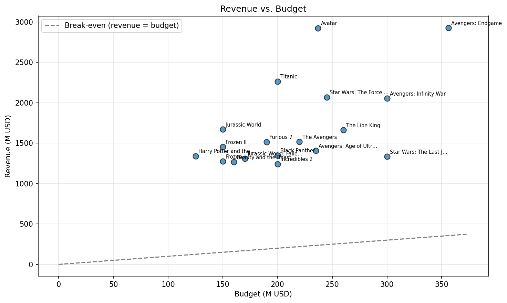
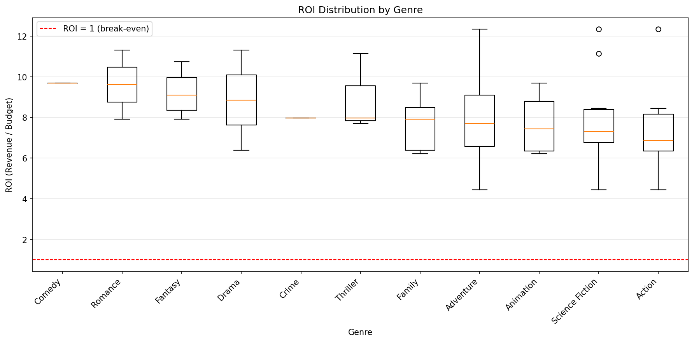

# TMDB Movie Data Analysis

A data analysis pipeline that fetches movie data from the TMDb API, cleans and
transforms it with Pandas, computes performance KPIs, and visualizes key insights.

## Project Structure

```
tmdb-movie-analysis/
├── data/
│   ├── raw/            # raw API responses
│   └── processed/      # cleaned dataset
├── notebooks/
│   └── analysis.ipynb  # main workflow
├── src/
│   ├── fetch.py        # API data extraction
│   ├── clean.py        # cleaning and preprocessing
│   ├── kpis.py         # ranking and KPI functions
│   └── visualize.py    # plotting functions
├── requirements.txt
└── README.md
```

## Setup

1. Clone the repository and create a virtual environment:
```bash
   python -m venv venv
   source venv/bin/activate   # Windows: venv\Scripts\activate
   pip install -r requirements.txt
```
2. Get a free API key from [TMDb](https://www.themoviedb.org/settings/api).
3. Create a `.env` file in the project root:
```
   TMDB_API_KEY=your_api_key
   TMDB_ACCESS_TOKEN=your_access_token
```
4. Open `notebooks/analysis.ipynb` and run all cells.

## Methodology

1. **Data extraction:** fetched 19 movie IDs from the TMDb `/movie/{id}` endpoint, including credits.
2. **Cleaning:** dropped irrelevant columns, flattened JSON fields, fixed data types, handled missing values.
3. **KPI analysis:** ranked movies by revenue, profit, ROI, ratings, and popularity.
4. **Visualization:** explored budget vs. revenue, ROI by genre, yearly trends, and franchise performance.

## Key Findings

The analysis covers 18 movies (ID 0 returned a 404 from the API and was skipped). Together they earned **$30,583M** in revenue on a combined budget of **$3,848M**, about 7.9 times their cost.

### Financial performance
- **Highest revenue:** Avengers: Endgame ($2,927.45M), which also had the largest budget ($356M).
- **Highest profit and ROI:** Avatar, with $2,686.71M profit and an ROI of 12.34x on a $237M budget.
- **Lowest profit and ROI:** Star Wars: The Last Jedi ($1,034.41M profit, 4.45x ROI). Every movie in the dataset was highly profitable, so "lowest" is relative.
- A bigger budget did not guarantee higher revenue: Avatar matched Endgame's revenue with $119M less budget.

### Ratings and popularity
- **Highest rated and most popular:** Avengers: Infinity War (rating 8.24, popularity 120.25).
- **Most voted:** The Avengers (40,041 votes).
- **Lowest rated:** Jurassic World: Fallen Kingdom (6.52) and Jurassic World (6.70). Jurassic World still had the third-highest ROI (11.14x), showing that commercial success and audience ratings don't always align.
- Popularity and rating have a fairly strong positive correlation (**r = 0.77**).

### Search queries
- Neither search returned results: Bruce Willis does not appear in any of the 18 movies, and the dataset contains no Quentin Tarantino films starring Uma Thurman.

### Franchise vs. standalone
| Metric | Franchise (16) | Standalone (2) |
|---|---|---|
| Mean revenue | $1,690.78M | $1,765.14M |
| Median ROI | 7.84x | 9.62x |
| Mean budget | $218.00M | $180.00M |
| Mean popularity | 50.31 | 47.89 |
| Mean rating | 7.39 | 7.44 |

The two standalone movies (Titanic and Beauty and the Beast) slightly outperformed franchises on revenue, ROI and rating, but with only two films in that group, this result is not reliable.

### Franchises and directors
- **Top franchise:** The Avengers Collection, with 4 movies, $7,904.08M total revenue and the highest mean rating (7.95), followed by Star Wars ($3,402.63M) and Jurassic Park ($2,982.01M).
- **Top director by revenue:** James Cameron ($5,187.87M from Avatar and Titanic).
- **Highest-rated directors:** Anthony and Joe Russo (mean rating 8.22, $4,979.86M total revenue).

### Visual insights
- All movies sit far above the break-even line in the revenue vs. budget plot.
- Romance, Fantasy and Comedy have the highest median ROI; Action and Science Fiction have the lowest, mainly because of their larger budgets.
- 2015, 2018 and 2019 have the highest total revenue, largely because most of the selected movies were released in those years.




### Limitations
The sample is small (18 movies) and made up entirely of blockbusters, the franchise and standalone groups are unbalanced, and revenue and budget figures are not adjusted for inflation. The results describe this group of films and should not be generalised to the wider film industry.

## Tools

Python, Pandas, NumPy, Requests, Matplotlib, Jupyter